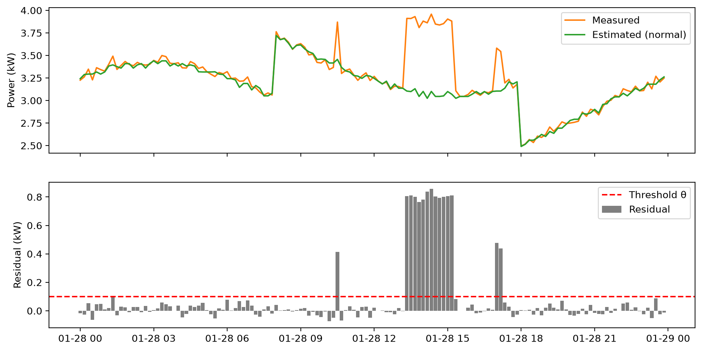

# Building Energy Anomaly Detection

A Python IoT project that estimates normal building power consumption and detects sustained excess power use. It uses 24 days of 10-minute readings and evaluates the detector against a maintenance log documenting a heater left on.

## Method

1. Split the data chronologically into 17 training days, 6 validation days, and 1 test day.
2. Estimate normal power with a Random Forest and compare its validation mean absolute error (MAE) with that of linear regression.
3. Calculate the residual as measured power minus estimated power. Set the alarm threshold to 0.01 kW above the largest validation residual.
4. Trigger an alarm after three consecutive readings exceed the threshold. Estimate excess energy during the alarm by multiplying each flagged residual by 1/6 hour and summing the results.

## Results

On 28 January 2026, the maintenance log recorded the heater running from 13:20 to 15:20. The alarm first triggered at **13:40**, a **20-minute delay**.

| Test-day metric | Result |
|---|---:|
| Heater-on intervals detected | 10 of 12 |
| False positives | 0 |
| Precision | 100% |
| Recall | 83.3% |
| Estimated excess energy during the alarm | About 1.3 kWh |



The sustained midday event triggered the alarm. The three-reading rule filtered out the shorter spikes shown in the residual plot.

## Run the notebook

From the repository root, run:

```bash
python -m pip install -r requirements.txt
cd notebook
jupyter notebook building_energy_anomaly_detection.ipynb
```

Run all cells from top to bottom. The notebook loads `../data/building_24days.csv` and saves the test-day plot to `../figure/test_day_anomaly.png`.

## Project files

| File | Purpose |
|---|---|
| [`notebook/building_energy_anomaly_detection.ipynb`](notebook/building_energy_anomaly_detection.ipynb) | Data exploration, model comparison, and anomaly detection |
| [`data/building_24days.csv`](data/building_24days.csv) | Building power, outdoor temperature, occupancy, and workday data |
| [`figure/test_day_anomaly.png`](figure/test_day_anomaly.png) | Test-day power and residual plot |
| [`requirements.txt`](requirements.txt) | Python dependencies |

Completed by **Damisa Rasaq Oluwasegun** as part of the IoT and Captors for Energy course at ECE Paris.